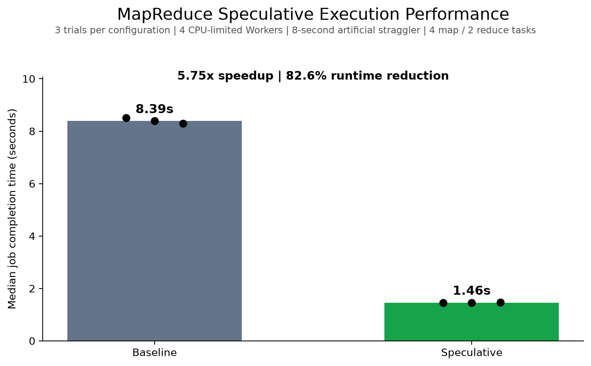

# CS 544 Honors Project 1: MapReduce

A Python MapReduce framework that runs on a single VM using **gRPC**, **Protocol Buffers**, and **Docker Compose**. A command-line client submits jobs to a Boss, which schedules map and reduce tasks across four Worker containers. The optional special feature is **straggler detection with speculative map execution**.

See [design.md](design.md) for the original design and [docs/speculative-execution.md](docs/speculative-execution.md) for the detection and scheduling details.

## Features

- **Client CLI:** submit jobs, follow progress, or look up an existing job ID.
- **Boss:** track job state; distribute map tasks; wait for the map phase before reducing; select shuffle inputs; and publish final output.
- **Workers:** run user-defined Python `map()` and `reduce()` functions and report task status through gRPC.
- **Shuffle:** write JSONL key/value records, partition keys deterministically with SHA-256, and send each reducer the selected partition files.
- **Shared storage:** a bind-mounted directory accessible to the Boss and Workers.
- **Speculative execution (optional):** detect a slow map task, launch one duplicate on an idle Worker, and use the first successful attempt's output.

```text
Client CLI (VM host)
       |
       | gRPC: SubmitJob / GetJobStatus
       v
      Boss
       |
       | gRPC: RunMap / RunReduce / GetTaskStatus
       v
  Worker 1   Worker 2   Worker 3   Worker 4
       \         |         |         /
        \--------+---------+--------/
                   |
          Shared /shared volume
        input / jobs / intermediate / output
```

## Requirements

- One Linux VM with **Docker Engine** and the **Docker Compose plugin**.
- **Python 3.12** and `venv` for the client running on the VM host.
- Docker access for the VM user. Each of the four Worker containers is limited to **one CPU** (`cpus: 1.0`); the Boss runs as a separate container.

Run the following commands from the repository root. The Docker image installs its own Python dependencies; the virtual environment below is for the **host-side client and tests**.

## Quick start: WordCount with Docker Compose

**1. Prepare the shared input and user-defined job file.**

```bash
mkdir -p shared/input shared/jobs shared/intermediate shared/output
cp examples/data/input.txt shared/input/input.txt
cp examples/wordcount.py shared/jobs/wordcount.py
```

**2. Build and start the Boss and four Workers.**

```bash
LOCAL_UID=$(id -u) LOCAL_GID=$(id -g) docker compose up --build -d
LOCAL_UID=$(id -u) LOCAL_GID=$(id -g) docker compose ps
```

Expect one healthy Boss and four healthy Workers. The Boss is reachable on the VM at `localhost:50050`. Worker ports are available inside the Compose network, not exposed on the VM host.

**3. Install dependencies for the client on the VM host.**

```bash
python3 -m venv .venv
source .venv/bin/activate
python -m pip install -r requirements.txt
```

**4. Submit WordCount from the VM host (outside Docker).**

```bash
python client.py \
  --boss localhost:50050 \
  --input /shared/input/input.txt \
  --output /shared/output/wordcount-1 \
  --job /shared/jobs/wordcount.py \
  --maps 4 --reduces 2
```

The client prints a job ID and reports the completed map/reduce counts. Wait until it reports `COMPLETED`, then inspect the output on the VM:

```bash
cat shared/output/wordcount-1/part-*.jsonl
```

The expected word counts, across both JSONL output parts, are:

| Word | Count |
| --- | ---: |
| `hello` | 2 |
| `world` | 3 |
| `mapreduce` | 1 |
| `distributed` | 1 |
| `computing` | 1 |

Output record order may vary. **Use a new output directory for each run**: the Boss refuses to overwrite nonempty output directories.

**Important:** The paths passed to `client.py` are absolute paths **inside the containers** (`/shared/...`), even though the client runs on the host. The local files live under `./shared/`; the CLI does not upload them.

### Client options

```bash
# Submit without waiting for completion:
python client.py --input /shared/input/input.txt \
  --output /shared/output/wordcount-2 \
  --job /shared/jobs/wordcount.py --maps 4 --reduces 2 --no-wait

# Resume monitoring with the ID printed by the client:
python client.py --status JOB_ID

# Query status only once:
python client.py --status JOB_ID --no-wait

# Stop monitoring after 60 seconds without cancelling the job:
python client.py --status JOB_ID --wait-timeout 60
```

Run `python client.py --help` for the complete option list. Job states are `QUEUED`, `RUNNING`, `COMPLETED`, and `FAILED`. Stopping the client does **not** cancel a running job.

## Special feature: straggler detection and speculative execution

A *straggler* is a task that runs much longer than similar tasks. When `BOSS_SPECULATE=1`, the Boss can launch another **attempt of the same map task** on an idle Worker instead of waiting only for the slow original.

The Boss:

1. Records map-attempt dispatch times and waits for at least one peer map to finish.
2. Flags a still-running map when its elapsed runtime reaches **both** the configured minimum (`BOSS_STRAGGLER_SECONDS`, default `1.0`) and **1.5 × the median duration** of completed map tasks.
3. Runs at most one duplicate (`attempt_id=1`) for an eligible map task, on a different idle Worker. Original pending tasks have priority.
4. Accepts the **first successful attempt** and passes only that attempt's reducer partitions to the reduce phase. A failed duplicate may fall back to the original.

Speculation is **off by default** and applies to **map tasks only**. There is no cancellation RPC; a Worker with a still-running losing attempt is kept unavailable until that attempt finishes or is marked unusable.

### Reproduce a straggler and compare both modes

The optional `compose.straggler.yaml` configuration delays **Worker 1, map task 0, attempt 0** by eight seconds. A speculative `attempt_id=1` is not delayed. Use the **regular** `examples/wordcount.py` with this simulation; no special input marker is needed.

First, run the baseline **with the delay but without speculation**:

```bash
LOCAL_UID=$(id -u) LOCAL_GID=$(id -g) BOSS_SPECULATE=0 \
  docker compose -f compose.yaml -f compose.straggler.yaml up --build -d

python client.py --input /shared/input/input.txt \
  --output /shared/output/baseline-run \
  --job /shared/jobs/wordcount.py --maps 4 --reduces 2
```

Then enable speculative scheduling and run the **same workload**, using a fresh output directory:

```bash
LOCAL_UID=$(id -u) LOCAL_GID=$(id -g) BOSS_SPECULATE=1 BOSS_STRAGGLER_SECONDS=1 \
  docker compose -f compose.yaml -f compose.straggler.yaml up -d --force-recreate boss

python client.py --input /shared/input/input.txt \
  --output /shared/output/speculative-run \
  --job /shared/jobs/wordcount.py --maps 4 --reduces 2
```

Check for `Straggler detected` and `Accepted map task 0 attempt 1` in the Boss logs:

```bash
docker compose -f compose.yaml -f compose.straggler.yaml logs boss worker1 worker2 worker3 worker4
```

Verify that both runs produce identical records (regardless of output-part order):

```bash
diff <(sort shared/output/baseline-run/part-*.jsonl) \
     <(sort shared/output/speculative-run/part-*.jsonl)
```

An empty `diff` means the sorted results match. Use the same input and task counts in both modes, and use separate output directories.

### Measured benchmark results

The team ran **three trials per configuration** through the Client → Boss → four-Worker Docker deployment. Each Worker was limited to one CPU. The workload used **4 map tasks and 2 reduce tasks**, with an **8-second artificial delay** on Worker 1 for map task 0, original attempt 0. The speculative duplicate was not artificially delayed.

| Trial | Baseline (s) | Speculative (s) |
| --- | ---: | ---: |
| 1 | 8.50 | 1.46 |
| 2 | 8.39 | 1.46 |
| 3 | 8.29 | 1.47 |
| **Median** | **8.39** | **1.46** |

This produced a **5.75× speedup** and an **82.6% reduction in median job completion time** in the controlled straggler scenario. Boss logs confirmed duplicate dispatch, and the end-to-end run completed successfully. These measurements **do not claim the same improvement on all inputs or cluster conditions**.



The source measurements are in [`benchmarks/results.csv`](benchmarks/results.csv). To regenerate the figure from the recorded data:

```bash
python -m pip install matplotlib  # plot dependency; not needed to run MapReduce
python benchmarks/plot_results.py
```

The script calculates the medians and speedup and saves `benchmarks/speculation_performance.png`.

## User-defined jobs and data formats

Provide a Python file defining:

- `map(key, value)`: receives a **zero-based input line number** and that line's text; yields zero or more `(key, value)` pairs.
- `reduce(key, values)`: receives a key and its grouped values; returns `(key, reduced_value)` or `None` to omit a result.

See [examples/wordcount.py](examples/wordcount.py) and [examples/slow_wordcount.py](examples/slow_wordcount.py). Input is split by **UTF-8 text lines** into balanced ranges; there is no built-in CSV/JSONL record parser or multiline CSV handling. User functions can parse their own line contents. Mapper intermediate records and reducer results are JSONL, with final files named `part-00000.jsonl`, `part-00001.jsonl`, and so on.

The Boss executes submitted jobs one at a time, but runs tasks within each phase concurrently on Workers. All maps must complete successfully before reducers begin.

## Tests

After activating the host Python environment, run:

```bash
PYTHONPATH=proto:. python -m unittest discover -s tests -p 'test_*.py' -v

# Focus on Boss scheduling, including speculative execution:
PYTHONPATH=proto:. python -m unittest discover -s tests -p 'test_scheduler.py' -v
```

The test suite covers the CLI, Boss RPC validation, Worker execution, shuffle/reduce, scheduler failures, and the real Boss/Worker pipeline. The scheduler tests also cover duplicate selection, baseline mode, fallback after a failed duplicate, and safe handling of losing attempts. Tests manage their own temporary servers and directories; Docker does not need to be running for the Python test suite. GitHub Actions runs the tests on pushes to `main` and pull requests.

## Repository layout

| Path | Purpose |
| --- | --- |
| `client.py` | Host-side submission and status CLI |
| `boss/` | Job records, gRPC server, scheduler and speculative execution |
| `worker/` | Map, shuffle, reduce, and Worker gRPC server |
| `proto/` | Protocol Buffer definitions and generated Python modules |
| `compose.yaml` | One Boss + four Workers on a shared Docker network |
| `compose.straggler.yaml` | Optional attempt-specific delay for straggler experiments |
| `examples/` | WordCount job files and example inputs |
| `tests/` | Unit and self-contained gRPC/integration tests |
| `benchmarks/` | Recorded baseline/speculation runtimes, plotting script, and performance chart |
| `docs/` | Additional design, deployment, and scheduling notes |
| `shared/` | Local runtime files (ignored by Git) |

## Limits and cleanup

- The system runs on **one VM**, not across multiple physical hosts.
- Job records are held **in memory**; restarting the Boss loses job IDs and statuses.
- There is **no task cancellation RPC** or general automatic retry of failed tasks. Speculation duplicates eligible slow map attempts; it is not a full fault-recovery system.
- Input and job files must remain available and unchanged until the job finishes. Run only **trusted** user-defined Python code; gRPC is configured without TLS for this course deployment.
- Intermediate workspaces are retained for debugging. A job is not complete until the Boss reports `COMPLETED`; failures during final publication may leave partial files.

Stop the deployment with:

```bash
LOCAL_UID=$(id -u) LOCAL_GID=$(id -g) docker compose down
```

Stopping the containers does **not** delete `./shared/` or the results it contains.
